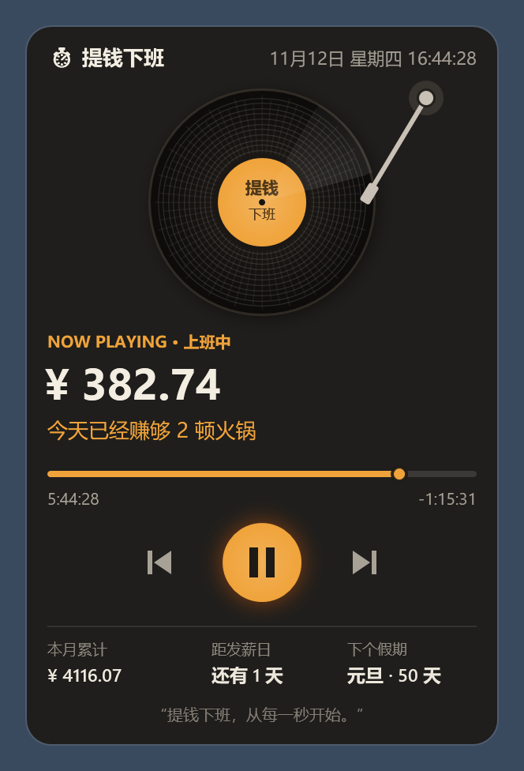
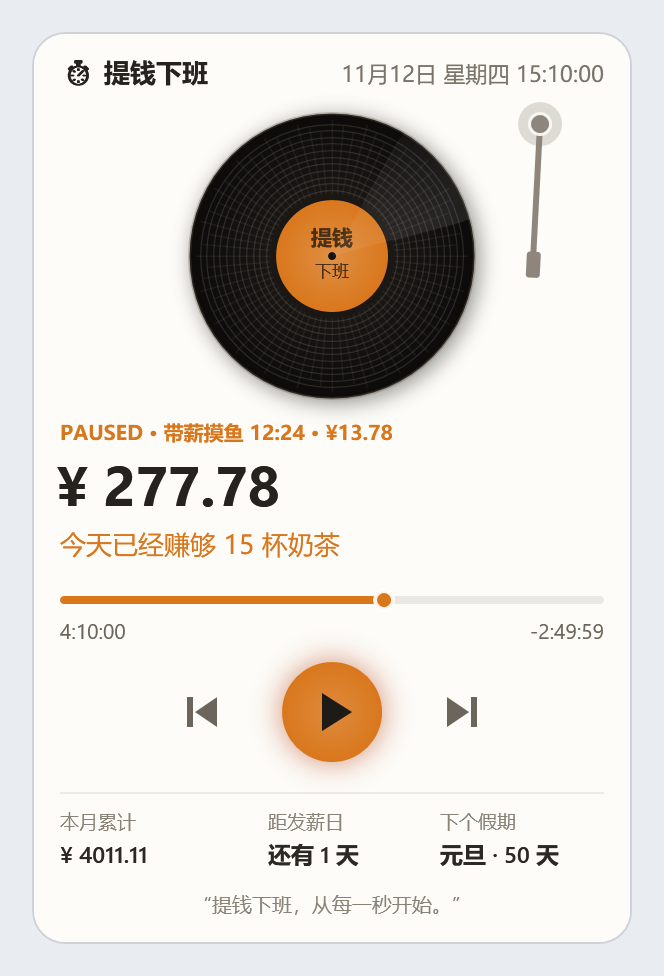
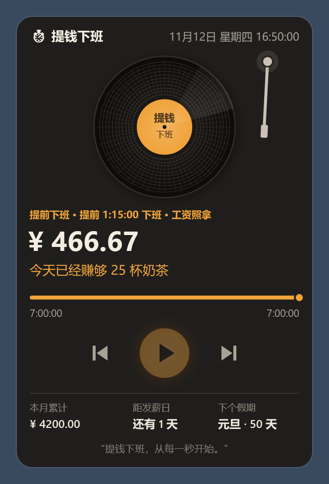
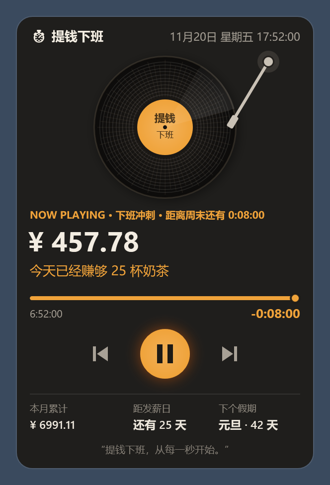
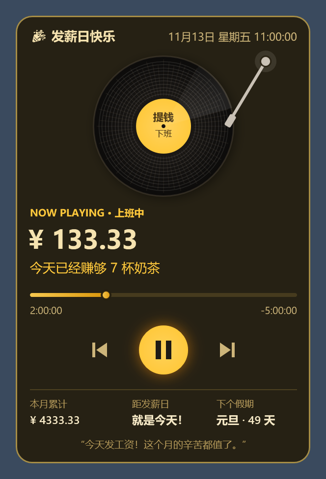
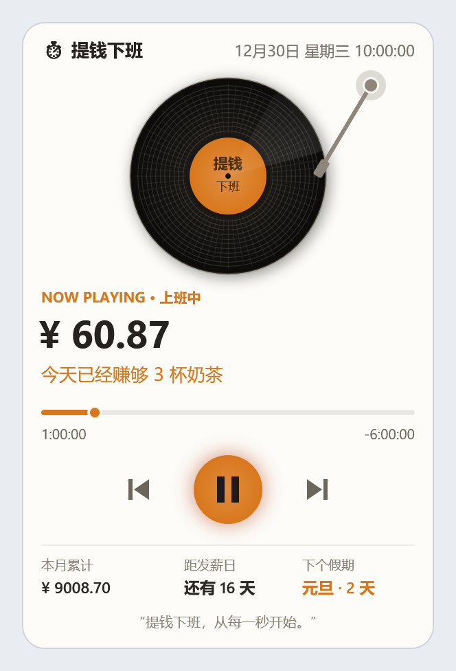
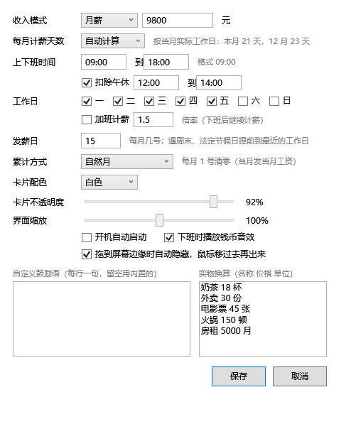

<div align="center">


# 提钱下班

**把工资按秒可视化的 Windows 桌面小唱机**

点 ▶ 开工，黑胶转起来；时间轴是今天的工时，「歌名」是今天已经赚到的钱，每秒都在涨。

[](#-快速开始) [](https://dotnet.microsoft.com/download/dotnet/8.0) [](LICENSE) [](#-常见问题) [](#-参与贡献)

[功能](#-功能) · [截图](#-截图) · [快速开始](#-快速开始) · [操作](#-操作) · [设置](#%EF%B8%8F-设置) · [从源码构建](#%EF%B8%8F-从源码构建) · [常见问题](#-常见问题)



</div>

---

## ✨ 功能

### 🎵 唱机界面

- **▶ 开工**：上班时间点一下，唱臂落下，黑胶开始转；午休、摸鱼时唱片停下
- **时间轴就是工作日**：左边是已经工作了多久，右边是还剩多久（`-1:15:32`）
- **⏸ 带薪摸鱼**：唱片停下，状态行实时显示「带薪摸鱼 12:24 · ¥13.78」；点 ▶ 结束，弹出"老板为你付了多少"
- **⏭ 提钱下班**：今天剩下的工资一次性到手，金额 1 秒内滚到满勤数，撒彩纸，哗啦啦撒一把金币，弹出「提钱下班！」；点错了再点一下撤销
- **⏮ 换一句鼓励语**

> 收入始终按你设置的上下班时间计算，▶ 只是开工的仪式感。

### 💰 计薪

- **每秒实时计薪**，支持月薪 / 日薪 / 时薪
- **按当月实际工作日计薪**（默认）：自动扣除法定节假日、计入调休补班，一个月全勤正好赚满月薪；也可以改成固定天数（如法定口径 21.75 天）
- **累计方式可选**：自然月 / 从上次发薪日起 / 每月固定某天起，适配不同公司的发薪和考勤规则
- **距发薪日**：发薪日碰上休息日，自动提前到最近的工作日
- **内置 2026、2027 年法定节假日与调休**，节假日不计薪
- **加班计薪**：下班后按倍率继续计（默认关闭）

### 🎉 情绪价值

| 功能 | 效果 |
|---|---|
| 🍜 实物换算 | 「今天已经赚够 3 杯奶茶」「本月房租已赚到 62%」，每 8 秒换一样，清单可自定义 |
| 🏖️ 假期倒计时 | 「元旦 · 50 天」，3 天内变橙色，放假前一天提醒 |
| 😤 免费加班心疼值 | 没开加班费还在加班：「免费加班中 · 47:00 · 老板白嫖 ¥78.33」，只在你人在电脑前时计时 |
| 🏃 下班冲刺 | 最后 10 分钟倒计时变大变橙，最后 1 分钟闪烁；下班那一刻撒彩纸，再撒一把金币（有声音的那种）🪙 |
| 🍻 周五特效 | 周五（或放假前一天）下午变成「距离周末还有 2:15:30」 |
| 🪙 发薪日彩蛋 | 整台唱机换成金色主题，鼓励语换成庆祝版 |
| 💬 鼓励语 | 每 5 分钟换一句，可以写成你自己的 |

### 🖥️ 桌面体验

- **贴边隐藏**：拖到屏幕边缘自动缩进去，只露一条边，鼠标移过去再滑出来；多显示器只贴最外侧的边
- **极简模式**：双击切换成一张带小唱片的迷你卡片，显示「7:04:22 后下班」
- **托盘图标**、**开机自启**、**深色 / 白色主题**、**50%~150% 缩放**
- **不打扰**：置顶显示，但不占任务栏、不进 Alt+Tab；高分屏、多显示器都清晰
- **纯本地**：不联网，不上传任何数据

## 📸 截图

| 上班中 | 带薪摸鱼 | 提钱下班 |
|:---:|:---:|:---:|
|  |  |  |
| **周五下班冲刺** | **发薪日** | **假期快到了** |
|  |  |  |

<div align="center">

**下班那一刻** · **极简模式**

 &nbsp; 

</div>

## 🚀 快速开始

### 1. 下载

在 [Releases](../../releases/latest) 页面下载（或自己[从源码构建](#%EF%B8%8F-从源码构建)），两个版本都是单个 exe，免安装：

| 文件 | 大小 | 适用 |
|---|---|---|
| `提钱下班.exe` | ~0.7 MB | 已安装 [.NET 8 桌面运行时](https://dotnet.microsoft.com/download/dotnet/8.0) |
| `提钱下班-独立版.exe` | ~69 MB | 任何 Windows 10 / 11，开箱即用，适合直接发给同事 |

### 2. 运行

双击 exe，唱机会出现在屏幕右上角。

> [!NOTE]
> 第一次运行如果弹出「Windows 已保护你的电脑」，是因为 exe 没有代码签名，点「更多信息」→「仍要运行」即可。

### 3. 填工资

右键唱机 → **设置**，填上你的月薪、上下班时间、午休、发薪日，保存。然后点 ▶ 开工 🎶

## 🎮 操作

| 操作 | 效果 |
|---|---|
| ▶ | 开工（唱片转起来）；摸鱼时点 ▶ 结束摸鱼 |
| ⏸ | 带薪摸鱼（唱片停下） |
| ⏭ | 提钱下班；再点一下撤销 |
| ⏮ / 点底部鼓励语 | 换一句鼓励语 |
| 拖动 | 移动位置，下次启动还在原处 |
| 拖到屏幕边缘 | 贴边隐藏 |
| 双击 | 切换唱机 / 极简模式（极简模式点小唱片 = ▶ / ⏸） |
| 悬停在金额、时间轴、累计上 | 看今日满勤可得、赚钱速度、工时进度、累计起算日 |
| 右键 | 摸鱼 / 提钱下班 / 设置 / 极简模式 / 隐藏 / 开机自启 / 退出 |
| 托盘图标 | 单击显示 / 隐藏，右键打开菜单 |

## ⚙️ 设置

<details>
<summary><b>全部设置项</b></summary>

<br>



| 设置 | 说明 |
|---|---|
| 收入模式 | 月薪 / 日薪 / 时薪 |
| 每月计薪天数 | 月薪模式用。默认「自动计算」（显示本月、下月各几个工作日）；也可选「固定天数」，如 21.75 |
| 上下班时间、午休 | 勾选「扣除午休」时午休不计薪 |
| 工作日 | 周一到周日任意勾选 |
| 加班计薪 | 下班后按倍率继续计薪，默认 1.5 倍 |
| 发薪日 | 每月几号，遇休息日自动提前；只影响「距发薪日」 |
| 累计方式 | **自然月**（每月 1 号清零，当月发当月工资）/ **从上次发薪日起**（发上个月工资）/ **每月固定日起**（考勤跨月，如 26 号到次月 25 号） |
| 卡片配色、不透明度、界面缩放 | 深色 / 白色；50%~150% |
| 开机自动启动 | 写当前用户的启动项，不需要管理员权限 |
| 下班时播放钱币音效 | 下班、提钱下班时哗啦啦撒一把金币，默认开启 |
| 贴边自动隐藏 | 拖到屏幕边缘时自动隐藏 |
| 自定义鼓励语 | 每行一句，留空用内置的 |
| 实物换算 | 每行「名称 价格 单位」，如 `奶茶 18 杯`；单位写「月」按本月累计算进度，如 `房租 5000 月` |

配置保存在 `%APPDATA%\TiqianXiaban\config.json`，摸鱼和免费加班记录在同目录的 `stats.json`（保留最近 400 天）。删掉 `config.json` 即恢复默认。

</details>

<details>
<summary><b>计薪规则</b></summary>

<br>

```
时薪       = 月薪 ÷ 当月计薪天数 ÷ 每日计薪小时
计薪天数   = 当月实际工作日数（自动）或固定天数
每日计薪小时 = 下班 − 上班 − 午休（勾选扣除时）
今日已赚   = 已走过的计薪秒数 × 每秒工资（加班按倍率另计）
```

- 法定节假日不计薪；调休补班日正常计薪，即使没勾选周末为工作日
- 累计 = 从起点到昨天，每个工作日按**它所在月份**的日薪计满勤，再加上今天已赚

自动计算时每个月的日薪不同。以月薪 9800、双休为例：

| 月份 | 实际工作日 | 日薪 | 说明 |
|---|:---:|:---:|---|
| 2026 年 10 月 | 18 天 | ¥544.44 | 国庆放假 5 个工作日，10/10 周六补班 |
| 2026 年 11 月 | 21 天 | ¥466.67 | 无节假日 |
| 2027 年 2 月 | 15 天 | ¥653.33 | 春节放假 6 个工作日，2/14 周日补班 |

每个月全勤加起来都正好是 ¥9800。

</details>

## 🗓️ 节假日数据

数据在 [`src/Holidays.cs`](src/Holidays.cs)：`Periods` 是每段法定假期（名称、第一天、天数），`Makeup` 是调休上班日，来源是国务院办公厅每年发布的放假安排通知。

目前覆盖 **2026、2027 年**。每年 11 月新一年的安排公布后需要补充，欢迎提 PR 🙌

## 🛠️ 从源码构建

需要 [.NET 8 SDK](https://dotnet.microsoft.com/download/dotnet/8.0)：

```powershell
.\scripts\build.ps1                 # 轻量版 → dist\提钱下班.exe
.\scripts\build.ps1 -SelfContained  # 独立版 → dist\提钱下班-独立版.exe
```

- 独立版第一次打包要从 NuGet 下载 .NET 运行时包；公司网络先设置代理：`$env:HTTPS_PROXY = "http://代理:端口"`
- 如果旧版本正在运行，`build.ps1` 会先把旧 exe 改名为 `.old` 再放入新版本

<details>
<summary><b>开发与调试参数</b></summary>

<br>

```powershell
# 把某一时刻的唱机渲染成 PNG（用默认配置，不读你的设置）
TiqianXiaban.exe --render card.png --at "2026-11-10 11:14:10" --theme 0 [--mini] [--scale 1.0]
#   --started 已开工  --slack-min 12 正在摸鱼  --free-ot-min 47 免费加班  --left-min 30 已提钱下班

# 打印若干时刻的计算结果
TiqianXiaban.exe --calc out.txt "2026-11-10 12:30:00" "2026-10-01 10:00:00" --overtime "2026-11-10 19:00:00"
#   --fixed 固定 21.75 天  --period 1 从上次发薪日起累计  --user 读你自己的配置（只读）

# 在模拟时间线上检查摸鱼和免费加班（跨午休、跨零点、吃饭离开、回家）
TiqianXiaban.exe --funtest out.txt

# 自检：设置保存、极简模式、菜单、摸鱼、庆祝动画、发薪日、贴边隐藏、唱片转动、提钱下班、音效（自检时静音）
$env:TIQIAN_SELFTEST = "C:\temp\selftest"; .\TiqianXiaban.exe

# 真鼠标测试：会实际移动鼠标，右键唱机点「开始摸鱼」再结束（锁屏时无效）
$env:TIQIAN_MOUSETEST = "C:\temp\mousetest"; .\TiqianXiaban.exe
```

两种自检都使用独立的配置目录，可以和正在使用的那一份同时运行，不会改动你的设置。

</details>

### 项目结构

```
├── src/
│   ├── Payroll.cs         # 计薪：计薪时间段、按月折算日薪、累计、发薪日
│   ├── Holidays.cs        # 法定节假日与调休数据
│   ├── Fun.cs             # 摸鱼、实物换算、假期倒计时、免费加班、提钱下班
│   ├── CardView.cs        # 唱机界面与极简模式
│   ├── CardWindow.cs      # 悬浮窗、右键菜单、拖动
│   ├── EdgeDock.cs        # 贴边隐藏
│   ├── SettingsWindow.cs  # 设置窗口
│   ├── TrayIcon.cs        # 托盘图标
│   ├── Sounds.cs          # 下班的钱币音效
│   └── App.cs             # 主循环、通知、自检
├── assets/                # 图标、截图、coin.wav 音效
├── scripts/               # build.ps1 打包、draw_icon.py 生成图标、make_coin_sound.py 合成音效
└── dist/                  # 打包好的 exe
```

## ❓ 常见问题

<details>
<summary><b>不点 ▶ 开工，还算钱吗？</b></summary>

算。收入只看你在设置里填的上下班时间，▶ 只控制唱片转不转，是开工的仪式感。

</details>

<details>
<summary><b>提钱下班后，今天的钱会少吗？</b></summary>

不会。提钱下班按「月薪照发」处理：今天剩下的工资一次性计入，今日已赚直接变成满勤数。

</details>

<details>
<summary><b>为什么「本月累计」和工资条对不上？</b></summary>

默认按当月实际工作日折算日薪，适合「全勤拿满月薪」的直观感受。如果公司按法定 21.75 天折算，在设置里把「每月计薪天数」改成「固定天数 21.75」即可。另外累计方式要选对：当月发当月工资选「自然月」，发上个月工资选「从上次发薪日起」。

</details>

<details>
<summary><b>会上传我的工资数据吗？</b></summary>

不会。程序完全离线运行，不发起任何网络请求，所有数据只保存在本机的 `%APPDATA%\TiqianXiaban`。

</details>

<details>
<summary><b>提示缺少 .NET 怎么办？</b></summary>

装一下 [.NET 8 桌面运行时](https://dotnet.microsoft.com/download/dotnet/8.0)，或者直接改用 `提钱下班-独立版.exe`。

</details>

<details>
<summary><b>卡片找不到了？</b></summary>

单击任务栏右下角的托盘图标即可找回。拔掉外接显示器导致卡片跑到屏幕外时，会自动回到主屏右上角。

</details>

## 🤝 参与贡献

欢迎 Issue 和 PR！尤其是：

- 🗓️ 补充新一年的法定节假日与调休数据
- 💬 更多有趣的鼓励语、实物换算清单
- 🐛 Bug 反馈（附上截图和设置会更好排查）

提交前请先跑一遍自检和 `--funtest`，确认计薪结果没有变化。

## 📄 许可

[MIT](LICENSE) © 2026 提钱下班 contributors

<div align="center">

**祝每一位打工人都能早点提钱下班 🎶**

</div>
